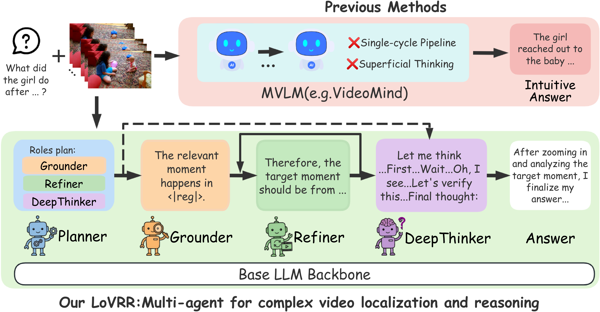

<div align="center">

# LoVRR: Reinforcement Learning-Enhanced Multi-Agent Video Localization and Reasoning

<p>
  <a href="#license"></a>
  <a href="https://www.python.org/"></a>
</p>

[**Project Page**](https://jasperh901.github.io/LoVRR/) | [**Model Weights**](#model-weights)

</div>


## Abstract

Complex video localization and reasoning requires cross-modal semantic alignment alongside precise temporal grounding over highly sparse timelines. Existing large language models often rely on superficial one-shot visual judgments and lack deep reasoning capabilities for complex temporal tasks, leading to localization and reasoning errors. In this paper, we propose **LoVRR** (**Lo**calize–**V**erify–**R**efine–**R**eason), a reinforcement learning-enhanced multimodal video reasoning agent. LoVRR makes two core contributions. First, we innovatively introduce temporal reward-based reinforcement learning into a multi-agent system, endowing lightweight Chain-of-Thought models with deliberative reasoning capabilities for precise temporal localization and inference in complex videos. Second, we propose **VG-MSR**, a novel LLM-guided self-refinement algorithm that performs multi-scale re-localization under semantic grounding accuracy rewards, effectively improving localization precision and robustness while reducing computational overhead. Extensive experiments on Grounded VideoQA and other benchmarks demonstrate that LoVRR achieves state-of-the-art performance on complex video understanding tasks.

## Overview

LoVRR follows a progressive *localize first, then think deeply* paradigm. The system first narrows the temporal search space to query-relevant evidence clips, and only then applies expensive deep reasoning to refined evidence. This design reduces distraction from long-video noise, makes temporal evidence selection explicit, and concentrates reasoning capacity on the most informative parts of the video.

<p align="center">
  
</p>

### Architecture

The framework consists of four specialized roles built on a unified Qwen2-VL backbone with **Chain-of-LoRA** adapters:

<p align="center">
  
</p>

| Role | Function |
|------|----------|
| **Planner** | Structured planning and query rewriting; routes to grounding or direct-answering paths |
| **Grounder** | Generates top-*k* candidate temporal segments via a timestamp decoder |
| **Refiner** | Binary confidence scoring, candidate reranking, and VG-MSR multi-scale boundary refinement |
| **DeepThinker** | Reinforcement learning-enhanced deep reasoning|

### Key Components

- **Chain-of-LoRA (CoL):** Role-specific LoRA adapters on a single backbone; enables seamless role switching with minimal parameter overhead.
- **VG-MSR:** Refiner-Guided Multi-Scale Search Refinement — treats the Refiner as a queryable critic and performs iterative multi-scale local search (8 directions × 3 step sizes) around initial proposals with explicit budget and risk control.
- **T-GRPO:** Temporally-aware Group Relative Policy Optimization — contrasts temporally ordered vs. shuffled frame sequences to reward temporal-order dependency and suppress shortcut reasoning.

## Project Structure

```
LoVRR/
├── lovrr/                          # Core framework
│   ├── model/                      # Model architecture (AgentQwen2VL + LoRA)
│   ├── dataset/                    # Dataset loaders and collators
│   ├── train/                      # Training scripts (SFT + custom trainer)
│   ├── utils/                      # Utility functions
│   └── constants.py                # Role prompts and special tokens
├── deepthinker_service.py          # DeepThinker vLLM-based FastAPI service
├── deepthinker_client.py           # DeepThinker HTTP client library
├── eval/                           # Evaluation scripts
│   ├── infer_cgbench_enhanced.py   # CG-Bench evaluation
│   ├── infer_mvbench_enhanced.py   # MVBench evaluation
│   ├── infer_timelens_enhanced.py  # TimeLens evaluation
│   └── deepthinker_answer_worker.py
├── config.yaml                     # Unified configuration
├── requirements.txt                # Python dependencies
├── start_all.sh                    # One-command launch (tmux)
├── start_lovrr.sh                  # Launch LoVRR service
└── start_deepthinker_service.sh    # Launch DeepThinker service
```

## Installation

### Prerequisites

- Python 3.11+
- CUDA 12.0+
- 2× GPUs with ≥48 GB VRAM

### Environment Setup

We recommend using **two separate conda environments** to avoid dependency conflicts 
```bash
# Clone the repository
git clone https://github.com/jasperh901/LoVRR.git
cd LoVRR

# --- Environment : LoVRR ---
conda create -n lovrr_env python=3.11 -y
conda activate lovrr_env
pip install torch==2.4.0 torchvision==0.19.0
pip install -r requirements.txt
pip install -e .

conda create -n deepthinker_env python=3.11 -y
conda activate deepthinker_env
pip install vllm==0.7.2
pip install fastapi uvicorn qwen_vl_utils
```


## Quick Start

### Option 1: One-Command Launch

```bash
./start_all.sh
```

This starts both services using `tmux`. To attach: `tmux attach -t lovrr-r1`.

### Option 2: Manual Launch

**Terminal 1 — DeepThinker Service:**

```bash
conda activate deepthinker_env
CUDA_VISIBLE_DEVICES=0 python deepthinker_service.py --config config.yaml
```

**Terminal 2 — LoVRR Demo:**

```bash
conda activate lovrr_env
CUDA_VISIBLE_DEVICES=1 python -m lovrr.demo.app_with_deepthinker
```

### Configuration

Edit `config.yaml` to set model paths and service parameters:

```yaml
deepthinker_service:
  model_path: "/path/to/DeepThinker-7B"
  use_vllm: true
  tensor_parallel_size: 1
  gpu_memory_utilization: 0.90
  max_model_len: 32768
  host: "127.0.0.1"
  port: 8002

lovrr:
  model_path: "/path/to/LoVRR-7B"
  base_model_path: "/path/to/Qwen2-VL-7B-Instruct"
  use_deepthinker_answerer: true
  host: "0.0.0.0"
  port: 7860
```

## Training

### Stage 1: Chain-of-LoRA SFT (Planner + Grounder + Refiner)

```bash
conda activate lovrr_env
deepspeed lovrr/train/train.py \
    --model_name_or_path /path/to/Qwen2-VL-7B-Instruct \
    --datasets /path/to/sft_data \
    --role planner \
    --output_dir outputs/planner_lora \
    --deepspeed ds_config.json
```

Repeat with `--role grounder` and `--role refiner` to train each adapter.

### Stage 2: DeepThinker (SFT Cold Start → T-GRPO RL)

DeepThinker training follows a two-stage recipe:
1. **SFT Cold Start:** Fine-tune on long-chain reasoning supervision data.
2. **T-GRPO Reinforcement Learning:** Optimize with temporally-aware group relative policy optimization using temporal-order and answer-correctness rewards.

Please refer to the training scripts in `lovrr/train/` for detailed configurations.

## Demo

<p align="center">
  
</p>

## Evaluation

### CG-Bench (Long Video, Grounded VideoQA)

```bash
conda activate lovrr_env
cd eval
python infer_cgbench_enhanced.py \
    --worker_id 0 \
    --num_workers 3 \
    --gpu 0
python aggregate_cgbench_results.py --input_dir outputs/cgbench
```

### MVBench (General Video QA)

```bash
cd eval
python infer_mvbench_enhanced.py \
    --data_path /path/to/mvbench \
    --output_dir outputs/mvbench
```

### Other Benchmarks

Evaluation on Video-MME, LVBench, NExT-GQA, and Charades-STA follows a similar pattern. See the `eval/` directory for details.

## VG-MSR Refinement Parameters

| Parameter | Default | Description |
|-----------|---------|-------------|
| `refine_iters` | 3 | Maximum refinement iterations |
| `budget` | 32 | Maximum Refiner evaluations per sample |
| `step_ratio` | 0.2 | Initial step size = segment_length × 0.2 |
| `step_min` | 1.0 s | Minimum step size |
| `step_decay` | 0.7 | Step decay factor per iteration |
| `skip_high` | 0.85 | Skip refinement if confidence ≥ 0.85 |
| `skip_low` | 0.15 | Skip refinement if confidence ≤ 0.15 |
| `gain` | 0.01 | Minimum improvement threshold to accept |

## Main Results

We evaluate LoVRR on **seven benchmarks** across three task categories.

### General Video QA

<table>
<tr><td>

**MVBench**

| Method | Size | Avg. |
|--------|------|------|
| *GPT-4V* | *—* | *43.5* |
| VideoChat2 | 7B | 60.4 |
| VideoMind | 7B | 64.8 |
| LLaVA-ST | 7B | 64.2 |
| **LoVRR** | **7B** | **67.6** |

</td><td>

**Video-MME**

| Method | Size | All | Long |
|--------|------|-----|------|
| *GPT-4o* | *—* | *71.9* | *65.3* |
| LongVA | 7B | 52.6 | 46.2 |
| VideoMind | 7B | 58.2 | 49.2 |
| Video-R1 | 7B | 59.3 | — |
| Apollo | 7B | 61.3 | — |
| **LoVRR** | **7B** | **63.0** | **53.7** |

</td><td>

**LVBench**

| Method | Size | Overall |
|--------|------|---------|
| *GPT-4o* | *—* | *30.8* |
| PLLaVA | 34B | 26.1 |
| **LoVRR** | **7B** | **40.0** |

</td></tr>
</table>

### Grounded VideoQA

<table>
<tr><td>

**CG-Bench**

| Method | Size | long-acc. | mIoU |
|--------|------|-----------|------|
| *GPT-4o* | *—* | *45.2* | *5.62* |
| VideoMind | 7B | 37.5 | 6.56 |
| Qwen2-VL | 72B | 41.3 | 3.58 |
| InternVL2 | 78B | 42.2 | 3.91 |
| **LoVRR** | **7B** | **37.8** | **6.65** |

</td><td>

**NExT-GQA**

| Method | Size | R@0.3 | mIoU | Acc@GQA |
|--------|------|-------|------|---------|
| HawkEye | 7B | 37.0 | 25.7 | — |
| VChat-TPO | 7B | 41.2 | 27.7 | 25.5 |
| **LoVRR** | **7B** | **47.6** | **30.1** | **24.6** |

</td></tr>
</table>

### Video Temporal Grounding — Charades-STA (Zero-Shot)

| Method | Size | FT | R@0.3 | R@0.5 | R@0.7 | mIoU |
|--------|------|----|-------|-------|-------|------|
| *R²-Tuning* | *—* | *✓* | *70.9* | *59.8* | *37.0* | *50.9* |
| E.T. Chat | 4B | ✗ | 65.7 | 45.9 | 20.0 | 42.3 |
| VideoChat-Flash | 7B | ✗ | — | — | — | 47.2 |
| VideoMind | 7B | ✗ | 73.5 | 58.4 | 29.8 | 49.6 |
| **LoVRR** | **7B** | **✗** | **74.8** | **59.0** | **31.7** | **50.6** |

## License

This project is released under the [BSD 3-Clause License](LICENSE).

## Acknowledgments

This project is built upon several excellent open-source works. We sincerely thank the authors for their contributions:

- **[VideoMind](https://github.com/yeliudev/VideoMind)**
- **[Video-R1](https://github.com/tulerfeng/Video-R1)**
- **[Qwen2-VL](https://github.com/QwenLM/Qwen2-VL)**
- **[PEFT](https://github.com/huggingface/peft)**
- **[vLLM](https://github.com/vllm-project/vllm)**
- **[DeepSpeed](https://github.com/microsoft/DeepSpeed)**
